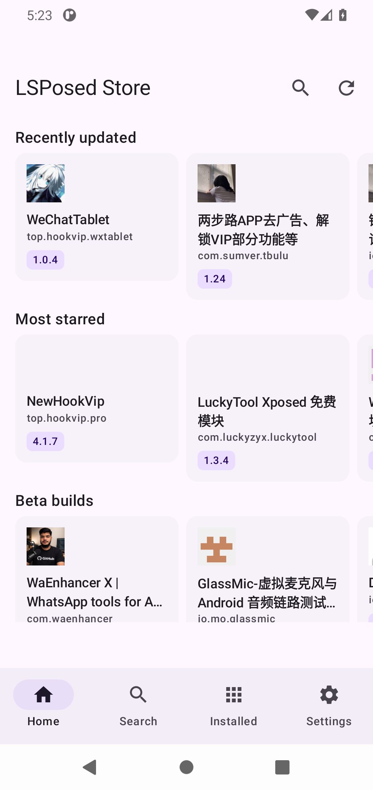
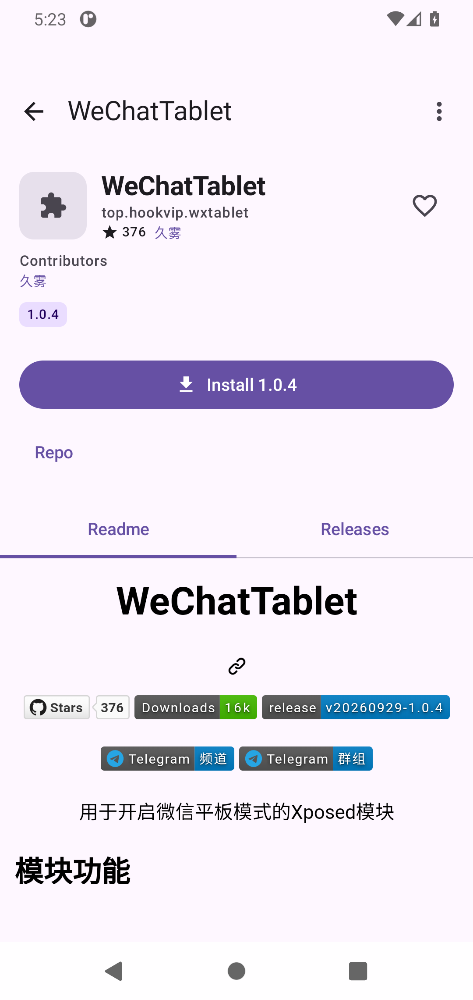
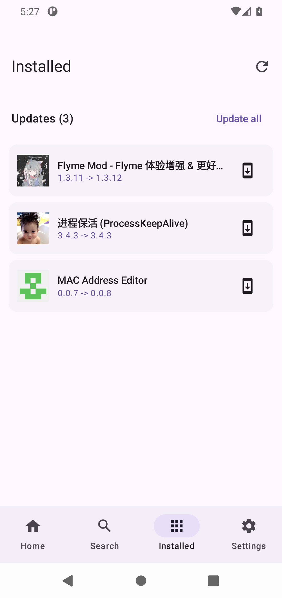

   
  

# LSP Store

An updater and browser for LSPosed modules

  <a href="README.md">中文</a> | <a href="README.en.md">English</a>

  
  
  
  

---

### Screenshots

  
  
  

---

### Download

[GitHub Releases](https://github.com/tophtab/lsp-store/releases/latest)

---

### Features

- Updating modules
- Browsing modules

---

### Credits

- [Komi Store](https://github.com/komi-store/komi-store) — the inspiration and prototype reference; the design language, layout and interaction patterns are borrowed from it
- [LSPosed](https://github.com/LSPosed/LSPosed) — the module framework and the public repository behind every module in the store
- [ScopeView](https://github.com/Xposed-Modules-Repo/io.github.zhongjitianqianguai.scopeview) — a similar project; iron sharpens iron
- [LINUX DO 社区](https://linux.do/) — 学AI，上L站
